<div align="center">

# 🏐 VolleyVision: Group Activity Recognition in Volleyball

[](https://www.python.org/)
[](https://pytorch.org/)
[](https://www.kaggle.com/datasets/sherif31/group-activity-recognition-volleyball)
[](#overview)
[](#results)

<p align="center">
  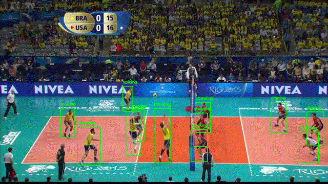
</p>

*A PyTorch benchmark of six architectures for multi-person temporal modeling and team-aware group activity classification in volleyball broadcasts, based on the CVPR 2016 hierarchical temporal formulation.*

[Overview](#overview) •
[Dataset](#dataset) •
[Methodology](#methodology) •
[Models](#model-architectures) •
[Results](#results) •
[Usage](#installation-and-usage) •
[Structure](#repository-structure)

</div>

---

## Table of Contents

- [Overview](#overview)
  - [Problem Statement](#problem-statement)
  - [Key Objectives](#key-objectives)
  - [Highlights](#highlights)
- [Dataset](#dataset)
  - [Group Activity Classes](#group-activity-classes)
  - [Annotation Structure](#annotation-structure)
  - [Video-Level Split](#video-level-split)
  - [Class Distributions](#class-distributions)
  - [Preprocessing Pipeline](#preprocessing-pipeline)
  - [Image Transformations](#image-transformations)
- [Methodology](#methodology)
- [Model Architectures](#model-architectures)
  - [Comparison Table](#comparison-table)
  - [Baseline 1](#baseline-1--single-frame-full-image-classifier)
  - [Baseline 4](#baseline-4--full-frame-temporal-lstm)
  - [Baseline 5](#baseline-5--frame-level-player-pooling--group-lstm)
  - [Baseline 6](#baseline-6--per-player-temporal-modeling--pooling)
  - [Baseline 7](#baseline-7--hierarchical-player--group-lstms-unified-pool)
  - [Baseline 8](#baseline-8--hierarchical-model-with-two-team-court-partitioning)
- [Training Configuration](#training-configuration)
- [Results](#results)
  - [Model Comparison](#model-comparison)
  - [Observations](#observations)
  - [Confusion Matrix](#confusion-matrix)
  - [Training Curves](#training-curves)
- [Installation and Usage](#installation-and-usage)
- [Repository Structure](#repository-structure)
- [Technologies Used](#technologies-used)
- [Limitations](#limitations)
- [Future Work](#future-work)
- [References](#references)

---

## Overview

**VolleyVision** benchmarks how spatial appearance, temporal dynamics, player-level representations, and team court structure contribute to recognizing coordinated group activities in volleyball video. Six end-to-end architectures are implemented, trained, and evaluated on a standardized video-level split. They progress from a single-frame CNN to a two-tier hierarchical LSTM with explicit court-side team partitioning (**Baseline 8**, the best-performing model).

<div align="center">
  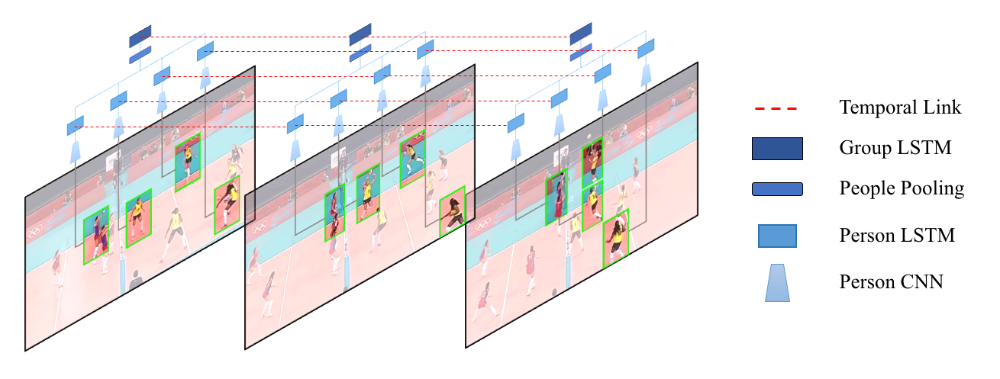
  <br/>
  <em>Original CVPR 2016 hierarchical formulation: person-level and group-level recurrence.</em>
</div>

### Problem Statement

Group Activity Recognition (GAR) classifies the *collective* activity of several interacting people, rather than the action of a single person. In volleyball, three properties make this difficult:

1. **Distributed context.** A macro-activity such as a *left set* or *right spike* cannot be read from one player's posture or from global scene appearance alone. It emerges from the coordinated positions and actions of many players.
2. **Concurrent spatiotemporal dynamics.** Players jump, block, set, and reposition simultaneously, so fine-grained individual trajectories must be modeled alongside the evolving team state (e.g., pass → set → spike).
3. **Tactical asymmetry.** Two opposing teams are separated by a net. Naive global pooling blends both teams' states and discards which side is doing what.

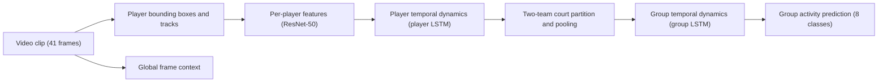

### Key Objectives

- **Backbone benchmarking:** compare ImageNet-pretrained ResNet-50 features on full frames versus localized player crops.
- **Hierarchical sequence modeling:** quantify the effect of temporal modeling at the frame, player, and group levels.
- **Team-partitioned aggregation:** compare uniform player pooling against court-side-aware pooling.
- **Reproducible evaluation:** provide config-driven training, validation, and held-out test pipelines with standardized classification metrics.

### Highlights

- **92.52 % test accuracy / 92.66 % macro-F1** for Baseline 8 on 16 held-out match videos.
- **+7.93 pp accuracy** from splitting players into two teams (Baseline 8) versus one unified pool (Baseline 7).
- **Strict video-level split** (24 / 15 / 16 videos) to prevent train/test leakage across broadcasts.
- A **pretrained Baseline 8 checkpoint** is included in `baseline8_model/`.

---

## Dataset

Experiments use the **Volleyball Group Activity Recognition** benchmark introduced by Ibrahim et al. (CVPR 2016), obtained from the [Kaggle mirror](https://www.kaggle.com/datasets/sherif31/group-activity-recognition-volleyball).

| Attribute | Specification |
| :--- | :--- |
| **Source videos** | 55 YouTube volleyball match videos (IDs `0`–`54`) |
| **Annotated clips** | 4,830 clips, each centered on an annotated keyframe |
| **Frames per clip** | 41 (20 before the keyframe, the keyframe, 20 after) |
| **Player annotations** | Bounding box `[x1, y1, x2, y2]`, player ID, and one of 9 individual action labels |
| **Group annotations** | One of 8 group activity labels per clip |

### Group Activity Classes

The 8 group activity labels and index mapping below are those defined in `dataset/volleyball_dataset.py` (`DatasetBaseline.GROUP_CATEGORIES`) and used across the YAML configs.

| Index | Label | Description | Court side |
| :---: | :--- | :--- | :---: |
| 0 | `l-pass` | Left team pass / bump | Left |
| 1 | `r-pass` | Right team pass / bump | Right |
| 2 | `l-spike` | Left team attack / spike | Left |
| 3 | `r_spike` | Right team attack / spike | Right |
| 4 | `l_set` | Left team overhead set | Left |
| 5 | `r_set` | Right team overhead set | Right |
| 6 | `l_winpoint` | Left team wins the point | Left |
| 7 | `r_winpoint` | Right team wins the point | Right |

> [!NOTE]
> Label strings are reproduced exactly as they appear in the dataset annotations, which mix hyphens (`l-pass`, `r-pass`, `l-spike`) and underscores (`r_spike`, `l_set`, `r_set`, `l_winpoint`, `r_winpoint`).

Player bounding boxes also carry one of **9 individual action labels** (`PERSON_CATEGORIES`): `waiting` (0), `setting` (1), `digging` (2), `falling` (3), `spiking` (4), `blocking` (5), `jumping` (6), `moving` (7), `standing` (8).

### Annotation Structure

```text
videos_root/
├── <video_id>/                  # 0, 1, ..., 54
│   ├── annotations.txt          # <clip_id>.jpg <group_activity_label>
│   └── <clip_id>/               # named after the keyframe ID (e.g. 29885)
│       └── <frame_id>.jpg       # 41 frames centered on the keyframe
annot_root/
└── <video_id>/
    └── <clip_id>/
        └── <clip_id>.txt        # player_id x1 y1 x2 y2 frame_id lost grouping generated category
```

<div align="center">
  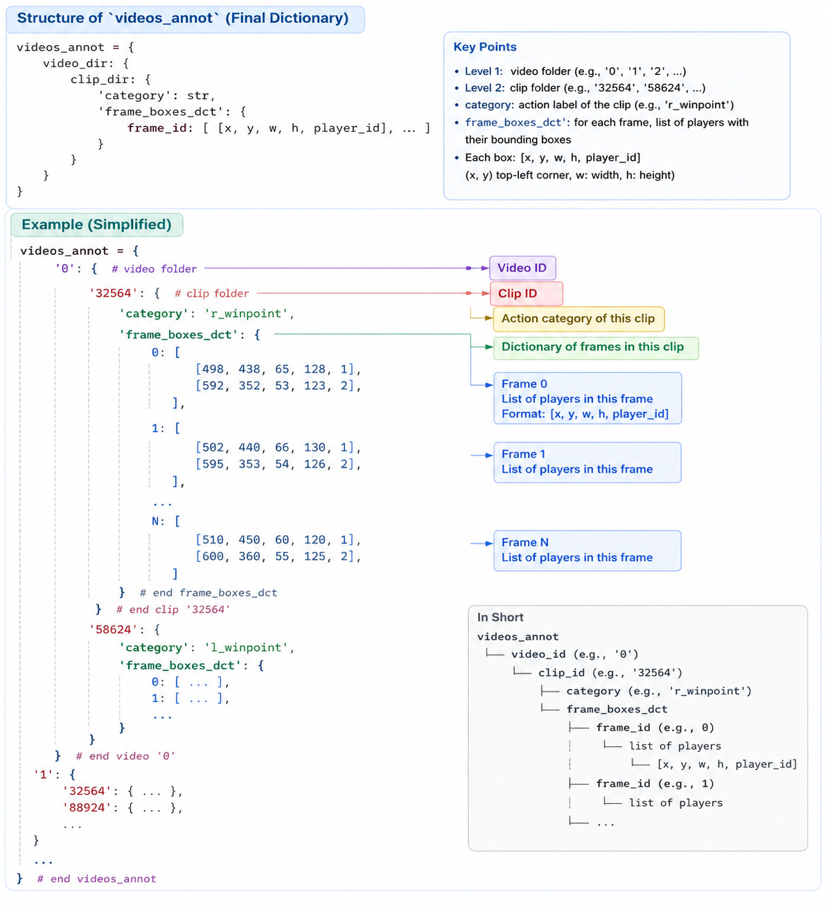
  <br/>
  <em>Annotation hierarchy: match → clip → frame → bounding box.</em>
</div>

<br/>

<div align="center">
  <table>
    <tr>
      <td align="center">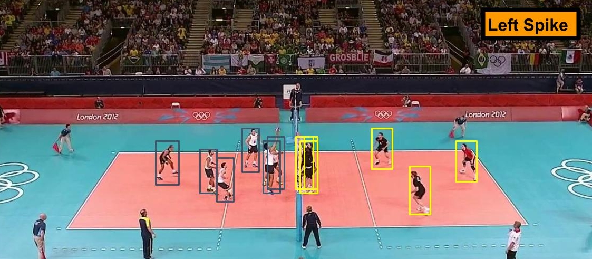</td>
      <td align="center">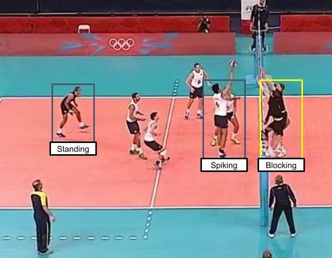</td>
    </tr>
    <tr>
      <td align="center"><em>Sample broadcast frame 1</em></td>
      <td align="center"><em>Sample broadcast frame 2</em></td>
    </tr>
  </table>
</div>

### Video-Level Split

All configs (`configs/baseline*.yaml`) use the same video-level partition of the 55 videos:

| Split | Videos | IDs |
| :--- | :---: | :--- |
| **Train** | 24 | `1, 3, 6, 7, 10, 13, 15, 16, 18, 22, 23, 31, 32, 36, 38, 39, 40, 41, 42, 48, 50, 52, 53, 54` |
| **Validation** | 15 | `0, 2, 8, 12, 17, 19, 24, 26, 27, 28, 30, 33, 46, 49, 51` |
| **Test** | 16 | `4, 5, 9, 11, 14, 20, 21, 25, 29, 34, 35, 37, 43, 44, 45, 47` |

> [!IMPORTANT]
> **Why split by video?** Clips from the same video share camera angle, arena lighting, uniforms, players, and spectators. Randomly splitting clips or frames across train and test lets a model memorize match-specific appearance and inflates accuracy. A video-level split tests generalization to unseen matches, teams, and venues.

### Class Distributions

<div align="center">
  <table>
    <tr>
      <th align="center" width="50%">Group activity classes (8)</th>
      <th align="center" width="50%">Individual action classes (9)</th>
    </tr>
    <tr>
      <td></td>
      <td></td>
    </tr>
  </table>
</div>

### Preprocessing Pipeline

1. **Annotation parsing** (`dataset/dataset_annotation.py`): reads tracking files, trims each player trajectory (`trim_start=5`, `trim_end=6`) to the central action window, pairs player crops with clip labels, and serializes everything into a nested dictionary saved as a `.pkl`.
2. **Deterministic spatial ordering** (`dataset/baseline_dataset_preparation.py`): within each frame, player boxes are sorted left to right by `x1` (`key=lambda p: p.box[0]`). This gives a consistent slot ordering along the player dimension and is what makes the Baseline 8 team split possible.
3. **Collation and masking** (`dataset/collate.py`): `collate_team_batch` zero-pads the player dimension to `max_players=12` and returns a boolean `player_mask` of shape `[B, 12]` (`True` = real player, `False` = padding).

### Image Transformations

Four torchvision pipelines are defined in `dataset/transforms.py`, all normalizing with ImageNet statistics (mean `[0.485, 0.456, 0.406]`, std `[0.229, 0.224, 0.225]`):

| Pipeline | Used for | Operations |
| :--- | :--- | :--- |
| **1** | Single full frame | Resize 256 → `CenterCrop(224)` → `ColorJitter(0.2, 0.2)` → `RandomRotation(15°)` → `RandomHorizontalFlip(0.5)` → `ToTensor` → `Normalize` |
| **2** | Single player crop | Resize `(224, 224)` → `ColorJitter(0.2, 0.2)` → `RandomHorizontalFlip(0.5)` → `ToTensor` → `Normalize` |
| **3** | Full-frame sequence | Resize 256 → `CenterCrop(224)` → `ColorJitter(0.2, 0.2)` → `ToTensor` → `Normalize` (no rotation or flip, to keep camera motion coherent across frames) |
| **4** | Player-crop sequence | Resize `(224, 224)` → `ToTensor` → `Normalize` (no spatial augmentation, to avoid artificial jitter across temporal crops) |

---

## Methodology

All player-based models share the same pipeline; the baselines differ in *where* temporal modeling and aggregation happen.

```text
Raw frames + bounding boxes
          │
          ▼
┌─────────────────────────────────┐
│ 1. Data ingestion and masking   │ ─► crop players, sort by x1, pad to 12, build mask
└───────────────┬─────────────────┘
                ▼
┌─────────────────────────────────┐
│ 2. Visual backbone (ResNet-50)  │ ─► 2048-d embedding per crop / frame
└───────────────┬─────────────────┘
                ▼
┌─────────────────────────────────┐
│ 3. Player dynamics (LSTM 1)     │ ─► per-player trajectory over time
└───────────────┬─────────────────┘
                ▼
┌─────────────────────────────────┐
│ 4. Team-aware aggregation       │ ─► masked max-pool per team (slots 0–5 vs 6–11)
└───────────────┬─────────────────┘
                ▼
┌─────────────────────────────────┐
│ 5. Group dynamics (LSTM 2)      │ ─► temporal evolution of the pooled team states
└───────────────┬─────────────────┘
                ▼
┌─────────────────────────────────┐
│ 6. Classification head          │ ─► linear layer → 8 group-activity logits
└─────────────────────────────────┘
```

How the baselines progressively add structure:

- **Baselines 1 and 4** treat the court holistically (global appearance, and global scene transitions over time).
- **Baselines 5 and 6** use player crops to remove background clutter and differ in whether pooling across players happens *before* (B5) or *after* (B6) temporal modeling.
- **Baselines 7 and 8** are two-tier hierarchies: a player-level LSTM, then pooling, then a group-level LSTM. Baseline 8 additionally separates the left and right teams before pooling.

Naming note: the *player LSTM* corresponds to `player_lstm` and the *group LSTM* to `image_lstm` in the code.

---

## Model Architectures

All six baselines are registered in `models/__init__.py` and selected through `scripts/train.py` via their YAML config:

```python
MODEL_REGISTRY = {
    "Baseline1": Baseline1, "Baseline4": Baseline4, "Baseline5": Baseline5,
    "Baseline6": Baseline6, "Baseline7": Baseline7, "Baseline8": Baseline8,
}
```

### Comparison Table

| Model | Input | Input shape | Temporal modeling | Player aggregation | Team split | Head |
| :--- | :--- | :--- | :--- | :--- | :---: | :--- |
| **Baseline 1** | Single frame | `[B, 3, 224, 224]` | None | None | ❌ | `Dropout(0.2)` → `Linear(2048, 8)` |
| **Baseline 4** | Frame sequence | `[B, F, 3, 224, 224]` | Frame LSTM (2048) | None | ❌ | `Linear(2048, 8)` |
| **Baseline 5** | Player-crop sequence | `[B, N, F, 3, 224, 224]` | Group LSTM (2048) | Masked max-pool per frame, **before** the LSTM | ❌ | `Linear(2048, 8)` |
| **Baseline 6** | Player-crop sequence | `[B, N, F, 3, 224, 224]` | Player LSTM (2048) | Masked max-pool **after** the LSTM | ❌ | `Linear(2048, 8)` |
| **Baseline 7** | Player-crop sequence | `[B, N, F, 3, 224, 224]` | Player LSTM (800) → Group LSTM (512) | Masked max-pool, all players | ❌ | `Linear(512, 8)` |
| **Baseline 8** | Player-crop sequence | `[B, N, F, 3, 224, 224]` | Player LSTM (800) → Group LSTM (512) | Masked max-pool **per team** | ✅ slots `[:6]` / `[6:]` | `Linear(512, 8)` |

`B` = batch size, `N` = padded players per frame (12), `F` = frames per sequence. Predictions come from the final time step.

### Baseline 1 — Single-Frame Full-Image Classifier

- **Code:** [`models/baseline1.py`](models/baseline1.py) · **Config:** [`configs/baseline1.yaml`](configs/baseline1.yaml)
- **Purpose:** a purely spatial, scene-level lower bound: how much can be inferred from one keyframe, with no temporal modeling and no player localization.
- **Architecture:** pretrained ResNet-50 (classification head removed) → `[B, 2048]` descriptor → `Dropout(0.2)` → `Linear(2048, 8)`.
- **Limitation:** no temporal reasoning.

### Baseline 4 — Full-Frame Temporal LSTM

- **Code:** [`models/baseline4.py`](models/baseline4.py) · **Config:** [`configs/baseline4.yaml`](configs/baseline4.yaml)
- **Purpose:** measure the benefit of whole-scene temporal dynamics without player crops.
- **Architecture:** ResNet-50 extracts a 2048-d vector per frame → single-layer LSTM (`input_size=2048`, `hidden_size=2048`) over `[B, F, 2048]` → final hidden state → `Linear(2048, 8)`.
- **Limitation:** captures global scene changes rather than localized player movement.

### Baseline 5 — Frame-Level Player Pooling + Group LSTM

- **Code:** [`models/baseline5.py`](models/baseline5.py) · **Config:** [`configs/baseline5.yaml`](configs/baseline5.yaml)
- **Purpose:** early aggregation. Player crops are pooled at each frame *before* temporal modeling.
- **Architecture:** ResNet-50 on all `B×N×F` crops → `Dropout(0.3)` → reshape to `[B, F, N, 2048]` → padded players masked with `-inf` and max-pooled over players → `[B, F, 2048]` → group LSTM → `Linear(2048, 8)`.
- **Limitation:** individual player trajectories are discarded before any temporal modeling.

### Baseline 6 — Per-Player Temporal Modeling + Pooling

- **Code:** [`models/baseline6.py`](models/baseline6.py) · **Config:** [`configs/baseline6.yaml`](configs/baseline6.yaml)
- **Purpose:** invert Baseline 5 by modeling each player's trajectory *before* aggregating across players.
- **Architecture:** ResNet-50 features as `[B×N, F, 2048]` → `player_lstm` (`hidden_size=2048`) per player → final state `[B, N, 2048]` → masked max-pool over valid players → `[B, 2048]` → `Linear(2048, 8)`.
- **Limitation:** no group-level LSTM to model how team state evolves.

### Baseline 7 — Hierarchical Player + Group LSTMs (Unified Pool)

- **Code:** [`models/baseline7.py`](models/baseline7.py) · **Config:** [`configs/baseline7.yaml`](configs/baseline7.yaml)
- **Purpose:** a full two-level temporal hierarchy without distinguishing the two teams.
- **Architecture:**
  1. ResNet-50 features `[B×N, F, 2048]`.
  2. `player_lstm` (`input_size=2048`, `hidden_size=800`) over each player's sequence.
  3. Reshape to `[B, F, N, 800]`; masked max-pool across *all* valid players at each time step → `[B, F, 800]`.
  4. `image_lstm` (`input_size=800`, `hidden_size=512`) over the pooled sequence.
  5. Final state `[B, 512]` → `Linear(512, 8)`.
- **Limitation:** uniform pooling merges both sides of the court into one vector, ignoring the net.

<div align="center">
  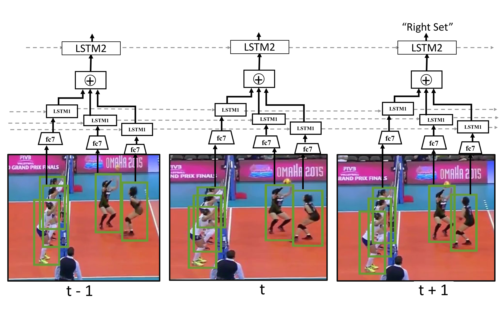
  <br/>
  <em>Two-stage temporal model illustration (player-level and group-level recurrence).</em>
</div>

### Baseline 8 — Hierarchical Model with Two-Team Court Partitioning

- **Code:** [`models/baseline8.py`](models/baseline8.py) · **Config:** [`configs/baseline8.yaml`](configs/baseline8.yaml)
- **Pretrained checkpoint:** [`baseline8_model/baseline8.pth`](baseline8_model/baseline8.pth) (~148 MB)

Baseline 8 is the primary and best-performing model. Because player slots are sorted left to right by `x1`, slots `0–5` are treated as the left team and `6–11` as the right team. Each team is pooled independently, and the two team vectors are concatenated before the group-level LSTM, which preserves per-side information that a unified pool would blend.

<div align="center">
  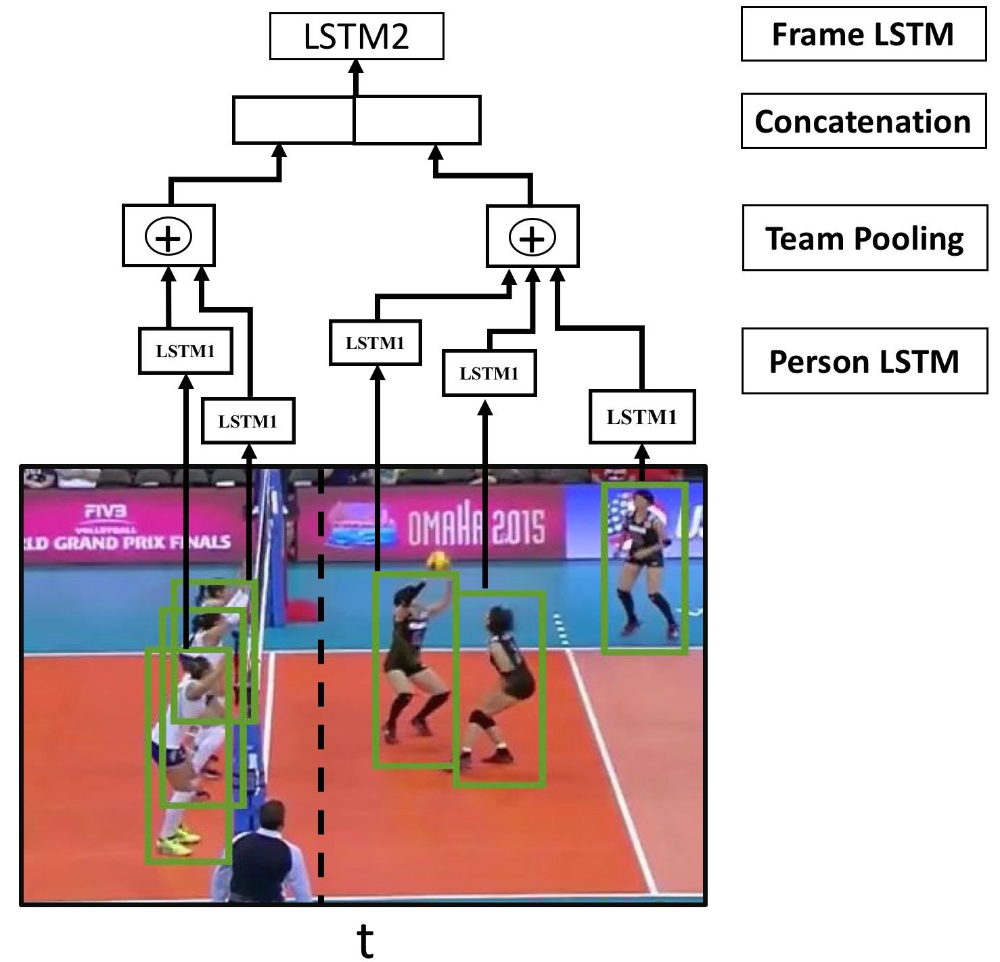
  <br/>
  <em>Baseline 8: ResNet-50 → player LSTM → two-team split and pooling → group LSTM.</em>
</div>

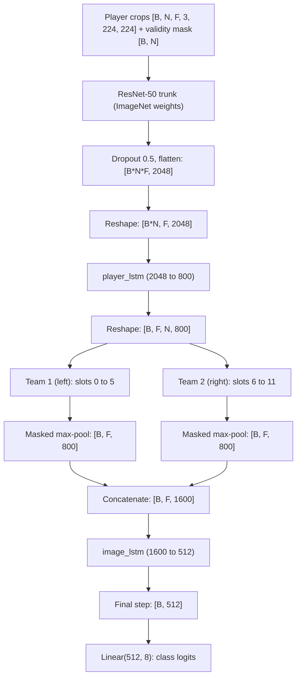

<!-- TODO(verify): the player-LSTM hidden size (800), concatenated size (1600) and group-LSTM input (1600) come from one draft; the other draft stated 1024 / 2048. Confirm against models/baseline8.py and configs/baseline8.yaml. -->

**Formulation**

1. **Feature extraction.** Each crop `x[b,n,t]` is mapped by the ResNet-50 trunk to a feature `f[b,n,t] ∈ ℝ²⁰⁴⁸`, followed by dropout (p = 0.5).
2. **Player recurrence.** A single-layer LSTM runs over each player's sequence: `h_player[b,n,t] = LSTM_player(f[b,n,t], h_player[b,n,t-1]) ∈ ℝ⁸⁰⁰`.
3. **Two-team partition.** Slots `0…5` form team 1 (left) and slots `6…N-1` form team 2 (right).
4. **Masked max-pooling.** Padded slots are set to `-inf` using the partitioned validity mask, so they never affect the max. Each team yields `z_team1[b,t], z_team2[b,t] ∈ ℝ⁸⁰⁰`.
5. **Fusion and group recurrence.** `z_match[b,t] = [z_team1[b,t] ‖ z_team2[b,t]] ∈ ℝ¹⁶⁰⁰` is fed to the group LSTM, producing `h_group[b,t] ∈ ℝ⁵¹²`.
6. **Classification.** `ŷ[b] = W · h_group[b,F] + bias`, with `W ∈ ℝ⁸ˣ⁵¹²`.

<div align="center">
  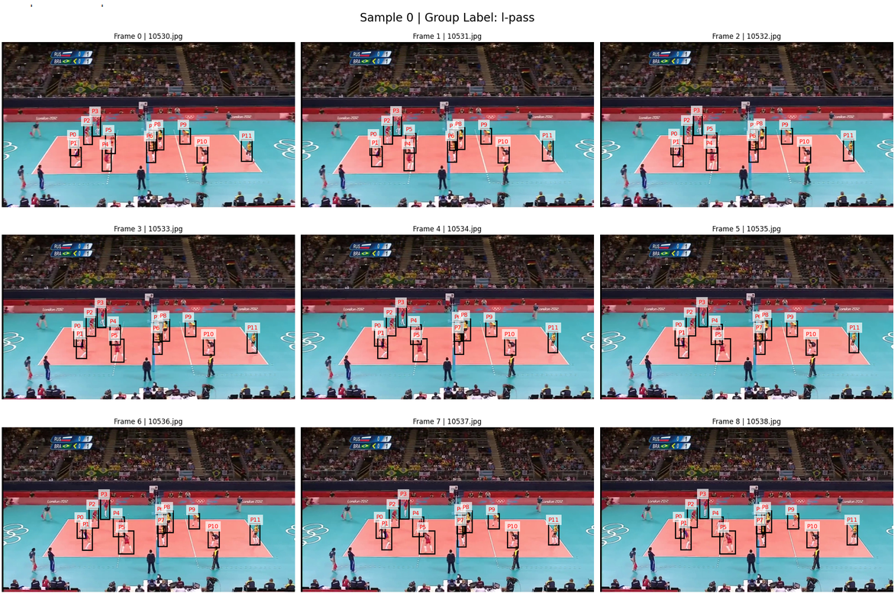
  <br/>
  <em>Temporal sequence of x1-sorted player crops with bounding-box coordinates.</em>
</div>

> [!NOTE]
> **Core idea:** unlike Baseline 7, Baseline 8 keeps the two opposing teams separate until fusion, preserving which side of the net each player's representation comes from.

---

## Training Configuration

Models are trained on the training videos with checkpoints selected by validation accuracy, using cross-entropy loss. Per-model settings from `configs/baseline*.yaml`:

| Model | Optimizer | Learning rate | Weight decay | LR scheduler |
| :--- | :--- | :---: | :---: | :--- |
| Baseline 1 | SGD (momentum 0.9) | 0.01 | 1e-5 | Cosine |
| Baseline 4 | SGD (momentum 0.9) | 0.01 | 1e-4 | Cosine |
| Baseline 5 | AdamW | 1e-4 | 0.01 | Cosine |
| Baseline 6 | AdamW | 1e-4 | 0.02 | Cosine |
| Baseline 7 | AdamW | 1e-4 | 0.02 | Reduce-on-plateau |
| Baseline 8 | AdamW | 1e-4 | 0.02 | Reduce-on-plateau |

Dropout: 0.2 (Baseline 1 head), 0.3 (Baseline 5 features), 0.5 (Baseline 8 features). Baseline 8 uses `batch_size: 2` with automatic mixed precision (`use_amp: true`). The training engine also provides checkpointing and early stopping.

---

## Results

### Model Comparison

All models were evaluated on the **16-video held-out test split**. Test metrics come from `results/test/<model>/metrics.json` and are rounded to two decimals; validation figures come from the training logs.

| Model | Description | Best val. acc. (%) | Best val. epoch | Test acc. (%) | Test macro-F1 (%) |
| :--- | :--- | :---: | :---: | :---: | :---: |
| **Baseline 1** | ResNet-50, single frame | 64.80 | 25 | 77.71 | 78.41 |
| **Baseline 4** | ResNet-50 + full-frame LSTM | 78.45 | 10 | 80.40 | 81.46 |
| **Baseline 5** | Player crops → pool → group LSTM | 82.70 | 9 | 84.44 | 80.75 |
| **Baseline 6** | Player crops → player LSTM → pool | 84.00 | 14 | 85.86 | 82.64 |
| **Baseline 7** | Hierarchical LSTMs, unified pool | 83.00 | 14 | 84.59 | 81.84 |
| **Baseline 8** | **Hierarchical LSTMs + two-team split** | **90.01** | 13 | **92.52** | **92.66** |

### Observations

1. **Temporal context helps.** Adding an LSTM over full frames (B1 → B4) improves test accuracy by **+2.69 pp**.
2. **Player localization helps more.** Moving from full-frame sequences (B4) to per-player modeling (B6) gives **+5.46 pp**, consistent with removing background and camera-motion distractors.
3. **Aggregation order matters modestly.** Modeling players over time before pooling (B6) beats pooling first (B5) by **+1.42 pp** accuracy and **+1.89 pp** macro-F1.
4. **Hierarchy alone is not enough.** The two-tier model with a unified pool (B7) does not beat the simpler B6 (84.59 % vs. 85.86 %).
5. **Court structure is the biggest gain.** Splitting players into two teams (B8) improves on the unified-pool B7 by **+7.93 pp accuracy** and **+10.83 pp macro-F1**. A plausible explanation is that team-separated representations disambiguate left/right classes (e.g., `l-spike` vs. `r_spike`); this has not been isolated by an ablation. Note also that B8's group LSTM receives a wider input (1600 vs. 800 dimensions) than B7's, so the gain is not purely attributable to the split.

> [!NOTE]
> Results are from the reported evaluation of each model; variance across random seeds is not reported. The original CVPR paper used a different backbone and training protocol, so its numbers are not directly comparable to the table above.

### Confusion Matrix

<div align="center">
  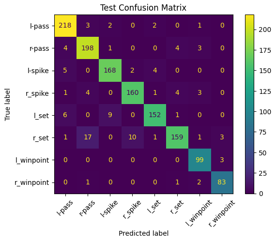
  <br/>
  <em>Baseline 8 confusion matrix on the held-out test split.</em>
</div>

Confusion matrices for all other baselines are in `results/test/<model>/test_confusion_matrix.png`.

### Training Curves

<div align="center">
  <table>
    <tr>
      <th align="center" width="50%">Baseline 8: loss</th>
      <th align="center" width="50%">Baseline 8: accuracy</th>
    </tr>
    <tr>
      <td>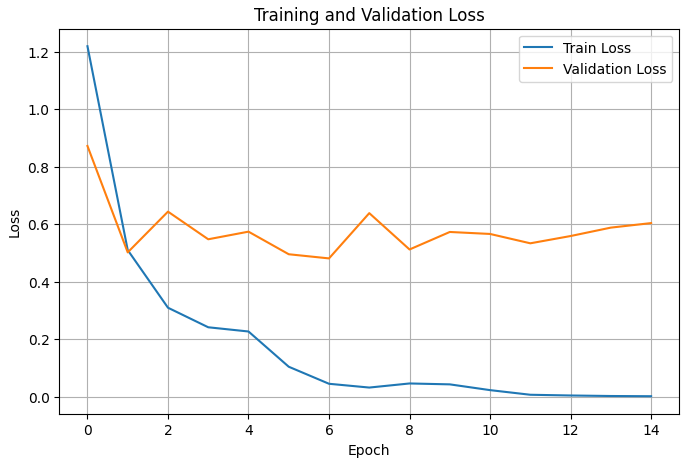</td>
      <td>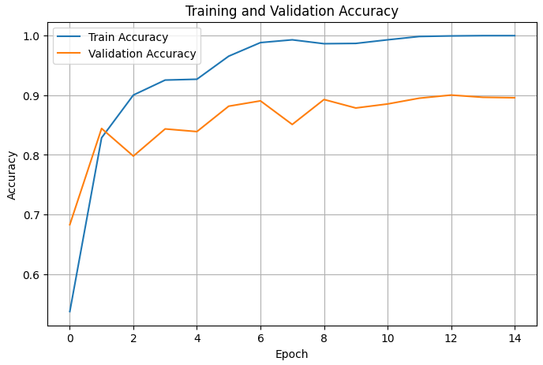</td>
    </tr>
  </table>
</div>

Baseline 8's best validation accuracy (90.01 %) occurs at epoch 13. At that epoch the training log reports a training accuracy of 99.91 % and a validation loss of 0.5588, a large train–validation gap that suggests overfitting to the 24 training videos.

<div align="center">
  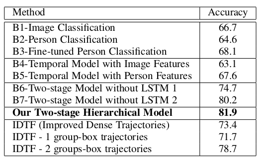
  <br/>
  <em>Baseline comparison table from the original CVPR 2016 paper, for reference.</em>
</div>

---

## Installation and Usage

### Prerequisites

- Linux (Ubuntu 20.04+ recommended)
- Python 3.10 – 3.12
- NVIDIA GPU with CUDA 11.8+/12.1+; **≥ 8 GB VRAM** recommended for the sequence models

### Setup

```bash
git clone <repository-url>
cd <repository-directory>

python3 -m venv .venv
source .venv/bin/activate          # Windows: .venv\Scripts\activate

pip install --upgrade pip setuptools wheel
pip install -r requirements.txt
```

Pinned dependencies in `requirements.txt` include `torch==2.5.1`, `torchvision==0.20.1`, `numpy~=1.26.4`, `scikit-learn~=1.5.2`, `PyYAML==6.0.2`, `Pillow~=10.4.0`, `matplotlib~=3.9.2`, `seaborn==0.13.2`, and `tqdm==4.66.5`.

### Dataset Preparation

1. Download the dataset from [Kaggle](https://www.kaggle.com/datasets/sherif31/group-activity-recognition-volleyball) and extract it:

   ```text
   /path/to/volleyball/
   ├── videos/          # 0/, 1/, ..., 54/
   └── annotations/     # 0/, 1/, ..., 54/
   ```

2. Build the serialized annotation file. Edit the `VIDEOS_ROOT`, `ANNOT_ROOT`, and `OUTPUT_PATH` constants at the bottom of [`dataset/dataset_annotation.py`](dataset/dataset_annotation.py), then run:

   ```bash
   python -m dataset.dataset_annotation
   ```

3. Point the config of the model you want to train at your data:

   ```yaml
   data:
     videos_root: /path/to/volleyball/videos
     videos_annot: /path/to/volleyball/annotations.pkl   # output of step 2
   ```

### Training

Pass a model's config to `scripts/train.py`. The script handles seeding, data loading, model construction, mixed-precision training, validation-based checkpointing, and test evaluation.

```bash
# Baseline 8 (hierarchical, two-team split)
PYTHONPATH=. python scripts/train.py --config configs/baseline8.yaml

# Other baselines
PYTHONPATH=. python scripts/train.py --config configs/baseline1.yaml
PYTHONPATH=. python scripts/train.py --config configs/baseline6.yaml
```

### Evaluation

Evaluate the included pretrained Baseline 8 checkpoint on the test split:

```bash
PYTHONPATH=. python -m scripts.evaluate \
  --config configs/baseline8.yaml \
  --checkpoint baseline8_model/baseline8.pth
```

Loading the checkpoint programmatically (see also [`utils/checkpoint.py`](utils/checkpoint.py) and [`baseline8_model/upload_model.py`](baseline8_model/upload_model.py)):

```python
import torch
from models.baseline8 import Baseline8

device = torch.device("cuda" if torch.cuda.is_available() else "cpu")
model = Baseline8(hidden_size1=800, hidden_size2=512, num_classes=8).to(device)

checkpoint = torch.load("baseline8_model/baseline8.pth", map_location=device, weights_only=False)
state_dict = checkpoint["model_state_dict"] if "model_state_dict" in checkpoint else checkpoint
model.load_state_dict(state_dict)
model.eval()
```

> [!WARNING]
> `weights_only=False` unpickles arbitrary objects. Only load checkpoints from sources you trust.

The repository does not currently include a standalone single-video inference script; inference is performed through the evaluation pipeline above.

---

## Repository Structure

```text
volleyball-group-activity-recognition/
├── LICENSE
├── README.md
├── requirements.txt
│
├── baseline8_model/
│   ├── baseline8.pth                    # Pretrained Baseline 8 weights (~148 MB)
│   └── upload_model.py                  # Checkpoint-loading helper
│
├── configs/                             # One YAML experiment config per baseline
│   ├── baseline1.yaml
│   ├── baseline4.yaml
│   ├── baseline5.yaml
│   ├── baseline6.yaml
│   ├── baseline7.yaml
│   └── baseline8.yaml
│
├── dataset/                             # Data loading, collation, annotation processing
│   ├── baseline_dataset_preparation.py  # Annotations → sample dictionaries (x1 sorting)
│   ├── BoxInfo.py                       # Parser for raw tracking lines
│   ├── collate.py                       # Padding to 12 players + validity mask
│   ├── dataset_annotation.py            # Raw annotation ingestion, .pkl serialization
│   ├── transforms.py                    # Transformation pipelines 1–4
│   └── volleyball_dataset.py            # DatasetBaseline and load_dataset factory
│
├── engine/                              # Training, evaluation, metrics
│   ├── __init__.py                      # Exports Trainer, Evaluator, metrics
│   ├── batch_utils.py                   # Tensor unpacking, device handling
│   ├── evaluator.py                     # Evaluation + confusion-matrix plotting
│   ├── metrics.py                       # Metrics and history plots
│   └── trainer.py                       # Training loop: AMP, checkpointing, early stopping
│
├── img/                                 # Figures, plots, and media used in this README
│   ├── action classes_statistics.png
│   ├── annotated_video2_preview.gif     # GIF preview shown at the top
│   ├── annotation_structure.png
│   ├── dataset1.jpg
│   ├── dataset2.jpg
│   ├── fig1.png
│   ├── fig2-b.png
│   ├── fig2-cvpr.png
│   ├── fig3.jpg                         # Baseline 8 architecture schematic
│   ├── group activity class_statistics2.png
│   ├── paper_resluts.png                # Results table from the original paper
│   └── sample_data_annot_baseline8.png
│
├── models/                              # Model implementations
│   ├── __init__.py                      # MODEL_REGISTRY
│   ├── baseline1.py
│   ├── baseline4.py
│   ├── baseline5.py
│   ├── baseline6.py
│   ├── baseline7.py
│   └── baseline8.py
│
├── results/                             # Saved metrics, plots, and logs
│   ├── README.md                        # Description of the result artifacts
│   ├── test/<baselineN>/                # metrics.json, test_confusion_matrix.png
│   └── training/<baselineN>/            # training curves and logs
│
├── scripts/
│   ├── evaluate.py                      # Evaluation CLI
│   └── train.py                         # Training CLI
│
├── utils/
│   ├── checkpoint.py                    # Checkpoint save/load
│   └── seed.py                          # Deterministic seeding
│
└── videos_sample/                       # Sample frames and dataset notes
    ├── 7/
    ├── 10/
    └── Info.txt                         # Dataset notes, splits, YouTube sources
```

---

## Technologies Used

| Area | Tools |
| :--- | :--- |
| Deep learning | PyTorch 2.5.1, Torchvision 0.20.1 (ImageNet-pretrained ResNet-50, LSTM, AMP) |
| Data and metrics | NumPy, scikit-learn, Pillow |
| Configuration | PyYAML |
| Visualization | Matplotlib, Seaborn |
| Utilities | tqdm |

---

## Limitations

- **Slot ordering is not tracking.** Players are sorted left to right by `x1` each frame. This gives a deterministic ordering but no persistent player identity: in crowded rallies where players cross paths, a player's tensor slot can change between frames, which affects the per-player LSTMs.
- **Fixed team heuristic.** Baseline 8 assumes slots `0–5` are the left team and `6–11` the right. Players are padded to 12 *after* sorting, so when fewer than 12 players are visible, or a side has other than six players in view (occlusion, camera pan), the partition can misalign with the true court sides. It also assumes a fixed court orientation.
- **Dependence on given bounding boxes.** The models consume ground-truth player boxes; no detector is included, so end-to-end performance on raw video is not evaluated.
- **Computational cost.** Every clip passes `B × 12 × F` crops through ResNet-50, so sequence models are memory-hungry (Baseline 8 uses batch size 2 with mixed precision).
- **Overfitting.** Baseline 8 reaches ~99.9 % training accuracy against ~90 % validation accuracy, and only 24 videos are used for training.
- **Single benchmark.** All results are on one dataset and one split protocol.

## Future Work

- [ ] Replace slot ordering with multi-object tracking (e.g., ByteTrack, Kalman filtering) for persistent player identities.
- [ ] Learn team assignment dynamically (soft attention or bipartite matching) instead of the fixed `[:6]` / `[6:]` split.
- [ ] Add an ablation separating the effect of the team split from the wider group-LSTM input.
- [ ] Replace recurrent units with spatiotemporal Transformers.
- [ ] Add an automatic player detector and a single-video inference script.
- [ ] Explore self-supervised pretraining on unannotated sports footage.

---

## References

1. M. S. Ibrahim, S. Muralidharan, Z. Deng, A. Vahdat, and G. Mori. **"A Hierarchical Deep Temporal Model for Group Activity Recognition."** *CVPR*, 2016, pp. 1971–1980.
2. K. He, X. Zhang, S. Ren, and J. Sun. **"Deep Residual Learning for Image Recognition."** *CVPR*, 2016, pp. 770–778.
3. Dataset: [Group Activity Recognition – Volleyball (Kaggle)](https://www.kaggle.com/datasets/sherif31/group-activity-recognition-volleyball), mirroring the original Volleyball dataset.

<details>
<summary>BibTeX</summary>

```bibtex
@inproceedings{ibrahim2016hierarchical,
  title     = {A Hierarchical Deep Temporal Model for Group Activity Recognition},
  author    = {Ibrahim, Mostafa S. and Muralidharan, Srikanth and Deng, Zhiwei and Vahdat, Arash and Mori, Greg},
  booktitle = {IEEE Conference on Computer Vision and Pattern Recognition (CVPR)},
  pages     = {1971--1980},
  year      = {2016}
}

@inproceedings{he2016deep,
  title     = {Deep Residual Learning for Image Recognition},
  author    = {He, Kaiming and Zhang, Xiangyu and Ren, Shaoqing and Sun, Jian},
  booktitle = {IEEE Conference on Computer Vision and Pattern Recognition (CVPR)},
  pages     = {770--778},
  year      = {2016}
}
```

</details>

**Acknowledgments:** the PyTorch and Torchvision teams for pretrained models and tooling, and the Simon Fraser University Computer Vision Lab for releasing the original Volleyball dataset and benchmark.
